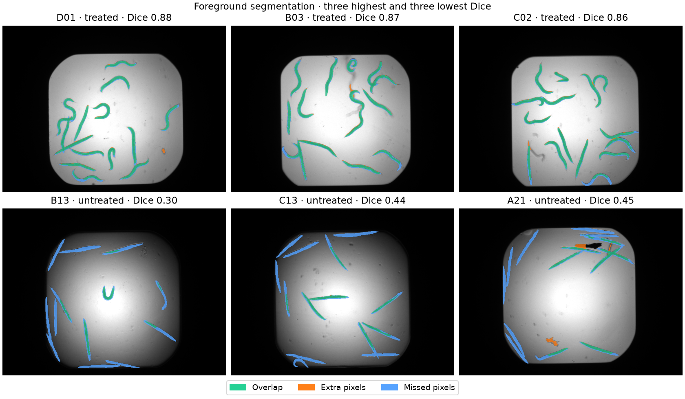
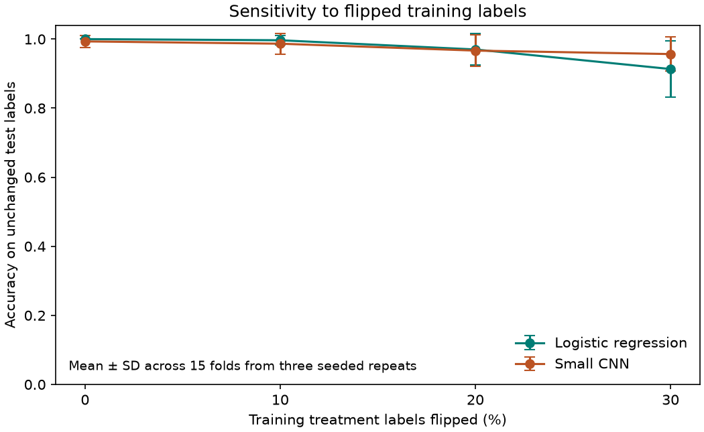

# Can simple image features distinguish BBBC010 treatment groups?

On this plate, logistic regression and a random forest both distinguished the treatment groups with 100% held-out-well accuracy. A small convolutional neural network (CNN) reached 99.3%. A control using pixels outside the wells reached 95%, showing that the images contain a strong group signal without visible worms.

## Data

BBBC010, contributed by Fred Ausubel to the Broad Bioimage Benchmark Collection, contains control wells from one 384-well plate and is released under CC0. The v2 image ZIP contains 200 usable TIFFs, two per well at 696 × 520 pixels in 16-bit files. Five additional TIFF-named entries are macOS bookkeeping. The mask ZIPs contain 100 corrected foreground masks and 1,407 individual outlines. The analysis scores the corrected foreground masks. [BBBC010 and the official archives](https://bbbc.broadinstitute.org/BBBC010) · [Ljosa et al., 2012](https://doi.org/10.1038/nmeth.2083)

The filename tokens `_<well>_w1_` and `_<well>_w2_` match the well in `<well>_binary.png`. All 199 TIFF stage labels that were present matched their filenames. The digits in the well token give the plate column. Columns 1–12 are the 52 ampicillin-treated wells (mostly live worms). Columns 13–24 are the 48 untreated wells (mostly dead worms). These are **treatment-level labels**. A well can contain a mixture of live and dead worms, and individual viability is unverified.

The dataset page describes channel 1 as brightfield and channel 2 as GFP, while all 100 `w1` TIFFs carry a TRITC fluorescence tag and 99 `w2` TIFFs carry a transmitted-light tag. The remaining `w2` file (A24) lacks the acquisition tag and was paired by filename. This project uses `w2` as brightfield and reports `w1` intensity as TRITC fluorescence. [Dataset page](https://bbbc.broadinstitute.org/BBBC010)

## Methods and segmentation results

The display shows six wells picked with a fixed seed. The treated examples contain many curved outlines. Rod-like outlines are more common in the untreated examples, although some straight worms appear in treated wells as well. These are still images, so they show posture at one instant. Display contrast is scaled independently for each panel.


The segmentation smooths each brightfield image, estimates the slowly varying background, trims the well rim, thresholds locally dark pixels with Otsu's method, closes gaps, fills holes and removes small connected regions. The human-corrected masks enter the scoring step. The baseline does not split touching worms.

| Pixel overlap across 100 wells | Mean ± SD | Min–max |
| --- | ---: | ---: |
| Dice | 0.720 ± 0.107 | 0.299–0.876 |
| Intersection over union (IoU) | 0.573 ± 0.123 | 0.176–0.780 |

The lowest-Dice examples miss several worms along the rim. Mean Dice was 0.775 for treated wells and 0.661 for untreated wells, so segmentation quality itself could contribute to differences in measured features. Wählby et al. reported 81% and 94% of individual worms segmented correctly after untangling, at an individual-worm F-factor threshold of 0.8. Those figures use a different unit and scoring rule from mean well-level pixel overlap. [Wählby et al., 2012, Evaluation of worm detection](https://pmc.ncbi.nlm.nih.gov/articles/PMC3433711/#S10)



The feature models get one row per well. It contains region count and the median region area, perimeter, major and minor axis lengths, eccentricity, solidity, elongation (major axis divided by minor axis) and mean TRITC intensity inside each segmented region. The CNN learns from both full images resized to 96 × 128 pixels with per-image contrast scaling. It has 5,177 trainable parameters and trains for 16 epochs on CPU.


## Classification results

All three models used the same three repeats of stratified five-fold cross-validation (80 training wells and 20 test wells per fold). The feature pipelines fit imputation and scaling where applicable on the training wells. Reported uncertainty is the standard deviation across the 15 folds, which reuse wells across repeats. The confusion matrices sum all 300 out-of-fold predictions. Untreated comes first in both rows (actual) and columns (predicted).

| Model | Accuracy ± SD | Balanced accuracy ± SD | ROC AUC ± SD | Confusion matrix |
| --- | ---: | ---: | ---: | --- |
| Logistic regression | 100.0% ± 0.0 pp | 100.0% ± 0.0 pp | 1.000 ± 0.000 | `[[144, 0], [0, 156]]` |
| Random forest | 100.0% ± 0.0 pp | 100.0% ± 0.0 pp | 1.000 ± 0.000 | `[[144, 0], [0, 156]]` |
| Small CNN | 99.3% ± 1.8 pp | 99.4% ± 1.7 pp | 1.000 ± 0.000 | `[[144, 0], [2, 154]]` |

The CNN ranked every treated well above every untreated well within each fold. At a probability cutoff of 0.5 it called two treated wells untreated across the three repeats, so its accuracy was slightly lower than the feature models'.

Shuffling one feature at a time on the held-out wells produced small average AUC drops. The largest reported drop for logistic regression was 0.008 for fluorescence intensity. The forest's largest was 0.002 for elongation, the length-to-width ratio of the fitted ellipse. Segmented regions had higher median elongation in untreated wells (12.485 versus 4.058). Several related measurements encode similar information, so the small drops give limited evidence about which feature matters most. [Per-fold permutation importance](outputs/feature_importance.csv)

### Artifact checks

- The model inputs exclude filenames, plate coordinates and TIFF metadata. Both channels from one well always stay together. Pixel hashing found zero exact duplicates across wells within either channel.
- Logistic regression on region geometry and count alone reached 99% accuracy. Using only the fluorescence intensity feature reached 100%.
- Logistic regression on the median and standard deviation of pixels in the outer 64 columns on each side reached 95% accuracy (ROC AUC 0.983). This control used both channels and sampled outside the visible wells. The 100 corrected masks had no marked foreground in those strips. Background brightness or noise is associated with treatment group on this plate.
- Holding out all sampled wells from test columns together still gave 100% accuracy for logistic regression on all features. Every held-out column still comes from the same plate, where column and treatment are linked. [Artifact check scores](outputs/artifact_checks.csv)

## Training-label flips

Each fold reused the same test wells and original test labels. A seeded permutation selected exactly 0, 8, 16 or 24 of the 80 training labels to flip. Both models got the same flips and the CNN reused its initialization seed across rates within a fold.

| Training labels flipped | Logistic accuracy ± SD | CNN accuracy ± SD |
| --- | ---: | ---: |
| 0% | 100.0% ± 0.0 pp | 99.3% ± 1.8 pp |
| 10% | 99.7% ± 1.3 pp | 98.7% ± 3.0 pp |
| 20% | 97.0% ± 4.6 pp | 96.7% ± 4.5 pp |
| 30% | 91.3% ± 8.1 pp | 95.7% ± 5.0 pp |

Both models lost accuracy under random training-label errors, and the CNN lost less at 30% in this experiment. The flips test sensitivity to incorrect treatment labels and cannot estimate the biological mixture of live and dead worms within either group.



## Reproduce

Run from the repository root with Python 3.14. The analysis uses pinned direct dependencies and fixed seeds. It ran on an Apple Silicon Mac with Python 3.14.5. A different OS or CPU may give small numerical differences.

```sh
python3.14 -m venv .venv
source .venv/bin/activate
python -m pip install -r requirements.txt
python scripts/00_download.py
python scripts/01_explore.py
python scripts/01_examples.py
python scripts/02_segment.py
python scripts/03_features.py
python scripts/04_classify.py
python scripts/05_cnn.py
python scripts/06_noise.py
```

The exploration script prints filename and TIFF-tag evidence and writes `data/labels.csv`. Segmentation and model scripts print their scores and save the underlying per-well or per-fold CSVs in `outputs/`. The plots regenerate in `outputs/figures/`. To reproduce the corrected-mask check for the artifact strips, run the following after downloading the data.

```sh
PYTHONPATH=scripts python - <<'PY'
from study import inventory, read_mask

_, masks = inventory()
affected = 0
for path in masks:
    mask = read_mask(path)
    affected += bool(mask[:, :64].any() or mask[:, -64:].any())
print(affected)
PY
```

## Limits

1. **Treatment and plate position are inseparable here.** All 100 wells are from one plate, with treatment determined by column and a strong outside-well signal. The 20-well test folds estimate performance on this plate. Zero spread for some metrics gives no estimate of performance on a new plate.
2. **Individual viability is unknown.** Treatment-level labels can group both live and dead worms in the same well. The scores measure agreement with the recorded treatment, and the synthetic flips do not measure biological label noise.
3. **Simple masks miss and merge worms.** Errors vary by group and are visible near the rim. Region counts are approximate. The published instance-untangling benchmark and this pixel-overlap experiment support no claim of a benchmark improvement.

[Beginner explainer](docs/EXPLAINER.md) · [Application notes](docs/APPLICATION_NOTES.md)
