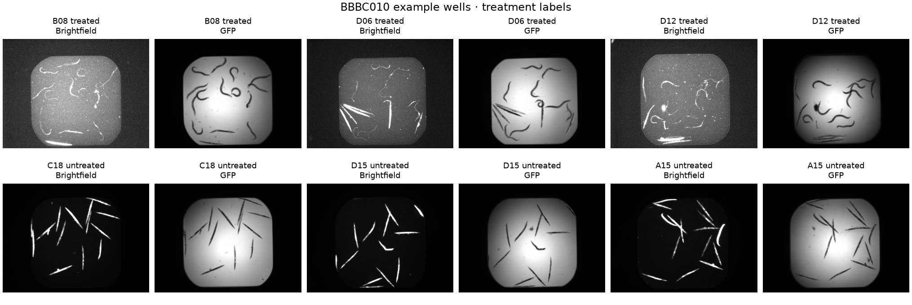
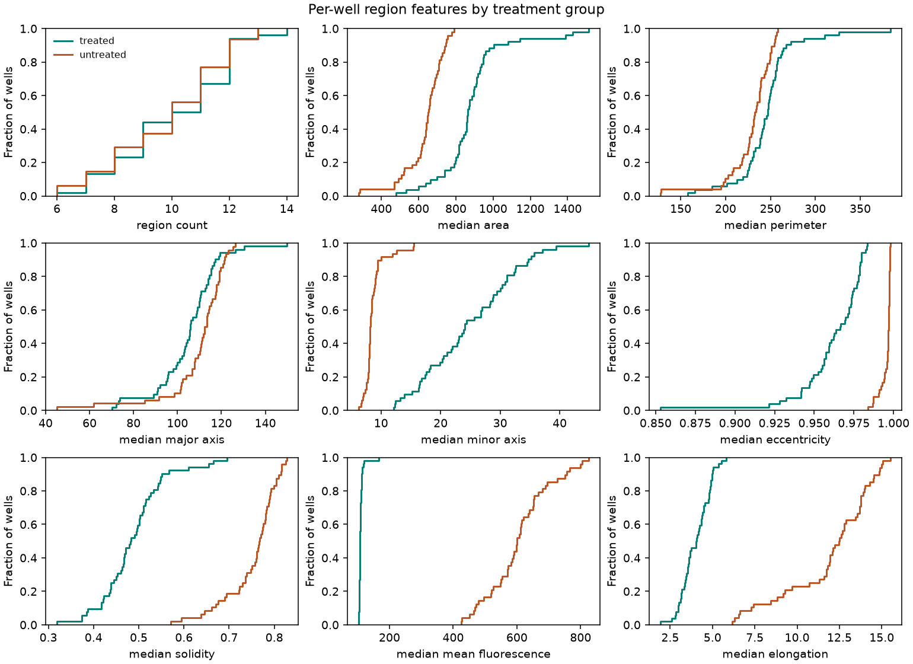

# Can a computer tell which worm wells got ampicillin?

My question was whether simple measurements of worm shape and brightness could tell which wells got ampicillin. I also wanted to see how those measurements compared with a small neural network trained on the images. The feature models reached 100% accuracy on held-out wells, but the background alone reached 95%. That result made me look more carefully at what the models could be picking up.

## How AI was used

I used **OpenAI Codex** to help turn my research question into a Python project. Codex wrote and ran the analysis code, generated the figures and result tables, and helped draft and revise the write-up. The three classifiers described below were fitted on the BBBC010 data. Codex was the coding and writing assistant.

## What was in the images?

The BBBC010 collection includes 100 wells from one 384-well plate. The image ZIP has two 16-bit TIFFs per well at 696 × 520 pixels, plus five macOS metadata files with TIFF filenames. The mask ZIPs contain 100 corrected foreground masks and 1,407 outlines of individual worms. Fred Ausubel contributed the dataset, and BBBC released it under CC0. [BBBC010 collection](https://bbbc.broadinstitute.org/BBBC010) · [Original BBBC paper](https://doi.org/10.1038/nmeth.2083)

A well ID like `A13` appears in both image filenames and in the mask name `A13_binary.png`. All 199 available TIFF stage labels agreed with the filenames. Columns 1–12 gave 52 ampicillin-treated wells, which mostly contain live worms. Columns 13–24 gave 48 untreated wells, which mostly contain dead worms. These are **treatment labels for whole wells**. The viability of each individual worm is unknown.

There was one detail worth checking before using the images. The dataset page lists brightfield and GFP, but the TIFF tags in the v2 download identify all 100 `w1` images as TRITC fluorescence and 99 `w2` images as transmitted light. The remaining `w2` file, from A24, lacks the tag and was paired by filename. The analysis uses `w2` for brightfield and calls the other channel TRITC. [Dataset page](https://bbbc.broadinstitute.org/BBBC010)

In the six randomly selected wells below, many treated worms look curved. Straight, rod-like shapes are more common in the untreated examples. Some treated worms look straight too. Each picture shows one moment, so scoring movement would take a series of images. Contrast was adjusted separately for each panel to make shapes easier to see.



## Finding worm pixels

The segmentation script smooths the brightfield image and estimates its background. It trims the well rim, then uses Otsu's method to pick out pixels darker than their surroundings. It closes small gaps, fills holes and removes isolated specks. Each predicted mask was scored against the corrected foreground mask for that well.

| Pixel overlap across 100 wells | Mean ± SD | Min–max |
| --- | ---: | ---: |
| Dice | 0.720 ± 0.107 | 0.299–0.876 |
| Intersection over union (IoU) | 0.573 ± 0.123 | 0.176–0.780 |

In the lowest-scoring overlays, several worms near the rim are missing. Mean Dice was 0.775 for treated wells and 0.661 for untreated wells. Because the two groups were segmented with different success, some of the differences in the measured features could come from the masks. The published 81% and 94% from Wählby and colleagues count individual worms that passed an F-factor threshold of 0.8 after untangling. The scores here measure foreground pixel overlap for whole wells. [Published worm-detection evaluation](https://pmc.ncbi.nlm.nih.gov/articles/PMC3433711/#S10)


## What was trained?

Each model learned the same task. Given a new well's image measurements or pixels, predict whether the well was treated with ampicillin or left untreated.

| Model | What it learned from |
| --- | --- |
| Logistic regression (scikit-learn) | One row of nine measurements per well. The model learned how to weight the scaled measurements to score the treatment group. |
| Random forest (scikit-learn) | The same nine measurements. The forest learned 150 decision trees and combined their predictions. |
| Small convolutional neural network (PyTorch) | Both full images for each well, contrast-scaled separately and resized to 96 × 128 pixels. It started from random weights in each fold and trained for 16 epochs on CPU, updating 5,177 parameters. |

The feature row holds a region count and eight medians across segmented regions. These summarize area, perimeter, major and minor axis lengths, eccentricity, solidity, elongation (long axis divided by short axis), and mean TRITC intensity inside each region. A region can be a single worm, a fragment or several touching worms.



## How well did the models do?

I wanted the three models to get the same test. All three used the same three rounds of five-fold cross-validation, with 80 training wells and 20 test wells per fold and new groupings each round. Both pictures and all measurements for a given well stayed together. The feature models estimated missing-value replacements and scaling values, where applicable, using their training wells.

The ± values show the standard deviation (SD) across 15 folds. The confusion matrices total 300 test predictions because each well is tested once per repeat. Rows show the actual group and columns show the predicted group, with untreated first.

| Model | Accuracy ± SD | Balanced accuracy ± SD | ROC AUC ± SD | Confusion matrix |
| --- | ---: | ---: | ---: | --- |
| Logistic regression | 100.0% ± 0.0 pp | 100.0% ± 0.0 pp | 1.000 ± 0.000 | `[[144, 0], [0, 156]]` |
| Random forest | 100.0% ± 0.0 pp | 100.0% ± 0.0 pp | 1.000 ± 0.000 | `[[144, 0], [0, 156]]` |
| Small CNN | 99.3% ± 1.8 pp | 99.4% ± 1.7 pp | 1.000 ± 0.000 | `[[144, 0], [2, 154]]` |

The CNN ranked the treated wells above the untreated wells in every fold. Two treated predictions still fell below the 0.5 cutoff, which brought its accuracy down to 99.3%.

To see which measurements mattered, the script shuffled one feature at a time among the test wells and checked how much AUC dropped. Fluorescence caused the largest average drop for logistic regression (0.008). Elongation caused the largest drop for the random forest (0.002). In the segmented images, the median of the per-well elongation values was 12.485 for untreated wells and 4.058 for treated wells. The AUC drops were small, and related measurements can carry similar information. [Feature importance results](outputs/feature_importance.csv)

## Could the models be taking a shortcut?

- Filenames, plate coordinates and TIFF tags were left out of the model inputs. A pixel-by-pixel hash check found zero exact duplicates across wells within either channel.
- Logistic regression reached 99% using region geometry and count alone and 100% using the fluorescence intensity feature alone.
- The biggest surprise was the background check. Logistic regression reached 95% accuracy (ROC AUC 0.983) using only median brightness and pixel variation from the outer 64 columns on each side of both images. None of the 100 corrected masks marks foreground in those strips.
- Logistic regression on all nine features still reached 100% when whole plate columns were held out together. Those test columns came from the same plate, where column position determines treatment. [Full shortcut-check results](outputs/artifact_checks.csv)

## What happens when some training labels are wrong?

The next test flipped the recorded treatment for 0, 8, 16 or 24 of the 80 training wells in each fold. Logistic regression and the CNN saw the same flips, and the CNN reused its starting seed across noise levels in a fold. The test wells kept their original treatment labels.

| Training labels flipped | Logistic accuracy ± SD | CNN accuracy ± SD |
| --- | ---: | ---: |
| 0% | 100.0% ± 0.0 pp | 99.3% ± 1.8 pp |
| 10% | 99.7% ± 1.3 pp | 98.7% ± 3.0 pp |
| 20% | 97.0% ± 4.6 pp | 96.7% ± 4.5 pp |
| 30% | 91.3% ± 8.1 pp | 95.7% ± 5.0 pp |

Both models lost accuracy as more labels were flipped. The CNN lost less at 30% in this experiment. Flipping treatment labels tests how the models handle mistakes in the training table. It leaves the real mix of live and dead worms in each well unknown.


## Reproduce

Open Terminal in the project folder and run these commands with Python 3.14. The project uses pinned direct dependencies and fixed seeds. The reported results came from an Apple Silicon Mac running Python 3.14.5. Other computers may give small numerical differences.

```sh
python3.14 -m venv .venv
source .venv/bin/activate
python -m pip install -r requirements.txt
python scripts/00_download.py
python scripts/01_explore.py
python scripts/01_examples.py
python scripts/02_segment.py
python scripts/03_features.py
python scripts/04_classify.py
python scripts/05_cnn.py
python scripts/06_noise.py
```

The scripts print the results as they run. You'll find labels in `data/labels.csv`, score tables in `outputs/`, and plots in `outputs/figures/`. After the download, you can run this check to count how many corrected masks mark worm pixels in the strips used for the background test.

```sh
PYTHONPATH=scripts python - <<'PY'
from study import inventory, read_mask

_, masks = inventory()
affected = 0
for path in masks:
    mask = read_mask(path)
    affected += bool(mask[:, :64].any() or mask[:, -64:].any())
print(affected)
PY
```

## What I can conclude

1. **These models separated the treatment groups on one plate.** The background result and the column layout make an independent plate important for finding out how well the models generalize.
2. **The data support a well-level treatment prediction.** A single well can contain both live and dead worms, and individual viability is unknown.
3. **The masks affect what the feature models see.** Worms near the rim can go missing, and touching worms can produce one region. The published worm-by-worm segmentation scores use a different measure from this project's pixel-overlap scores.

[Beginner explainer](docs/EXPLAINER.md) · [Application notes](docs/APPLICATION_NOTES.md)
